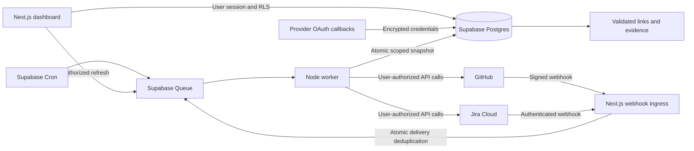

# DevSync

A unified GitHub and Jira workspace with evidence-backed delivery signals. Built with Next.js 16, React 19, TypeScript, Tailwind CSS, Radix UI primitives, TanStack Table, and Supabase.

## Run locally

Requirements: Node.js 22+ and npm. Supabase CLI is needed for database administration, not ordinary app startup.

```sh
npm ci
npm run dev
```

Open [the app](http://127.0.0.1:3000) or [the isolated demo](http://127.0.0.1:3000/demo). Start the queue consumer in another terminal:

```sh
npm run worker
```

The worker is required for imports. A queued refresh is not an immediate provider import. Keep one worker running in a deployed environment; queue leases protect concurrent consumers. App pages poll every 30 seconds while visible to show completed imports.

## Supabase project

Created for this project on 1 November 2026:

- Name: `devsync`
- Reference: `anjfnzzdkjuwzpebxwus`
- Region: Mumbai (`ap-south-1`)
- [Project dashboard](https://supabase.com/dashboard/project/anjfnzzdkjuwzpebxwus)
- All three database migrations have been applied. A SQL reconciliation job enqueues work every 10 minutes.

The local `.env.local` contains the project connection values and encryption key, is ignored by Git, and has restricted file permissions. Do not commit or share it. No provider credentials are stored in frontend code. `.env.example` documents the required variables for another environment. Preserve the encryption key when moving an environment; existing credentials cannot be decrypted with a different key.

For a fresh project:

```sh
cp .env.example .env.local
supabase link --project-ref YOUR_PROJECT_REFERENCE
supabase db push
npm run db:types
```

Set the Supabase URL, publishable key, server-side privileged key and token encryption key. Generate a token encryption key using `openssl rand -base64 32`. Enter generated secrets into your local ignored environment file or deployment secret store.

Supabase Auth is configured for email sign-in links. Local callback URLs include both `localhost:3000/auth/callback` and `127.0.0.1:3000/auth/callback`. Configure your actual production origin and callback URL before deployment. Supabase's default email service may restrict delivery to authorized addresses; configure production SMTP for general user onboarding. The app has no bundled user account or shared default password.

## Connect GitHub

Create a GitHub App you control. Configure:

- User authorization callback: `APP_ORIGIN/api/connect/github/callback`
- Setup URL: the same callback URL (or `APP_ORIGIN/connect/github`).
- Webhook URL: `APP_ORIGIN/api/webhooks/github` on a public HTTPS origin.
- A random webhook secret matching `GITHUB_WEBHOOK_SECRET`.
- Read-only repository permissions: Metadata, Contents, Pull requests, Checks, Commit statuses. Include Actions read permission for the imported workflow runs.
- Subscribe to push, pull request, pull request review, check run, check suite, status, installation and installation repository changes as permitted by the selected scopes.
- Enable expiring user access tokens so background access can be refreshed and revoked.

Set `GITHUB_CLIENT_ID`, `GITHUB_CLIENT_SECRET`, `GITHUB_APP_SLUG` and `GITHUB_WEBHOOK_SECRET`. Sign in to DevSync, connect GitHub, choose an accessible installation, then select repositories under Manage scope. If there are no installations, use the provided installation link and return to the selection page.

This version uses GitHub App **user access tokens** for reads. They enforce the intersection of the app installation and the authorizing user's access, including during background imports. An installation token alone would not preserve the viewer's narrower permissions. Tokens are rotated under a database lease and encrypted at rest. A GitHub App private key is not required by this implementation.

## Connect Jira Cloud

Create an Atlassian OAuth 2.0 (3LO) app with callback `APP_ORIGIN/api/connect/jira/callback`. Set `JIRA_CLIENT_ID` and `JIRA_CLIENT_SECRET`.

Requested scopes are `read:jira-work`, `read:jira-user`, `manage:jira-webhook`, `offline_access`, `read:board-scope:jira-software`, and `read:sprint:jira-software`. The app reads work-item business data; webhook-management scope is used only for event registration/renewal. Validate scope availability in your developer console and remove Jira Software scopes if your edition does not support those features.

Connect Jira, choose a site, and select projects. The worker discovers custom sprint field IDs, searches using `/rest/api/3/search/jql`, and follows its page tokens. It does not hardcode custom field IDs.

On a public HTTPS origin, the worker registers issue webhooks, renews them before their 30-day expiry and replaces filters after scope changes. Private OAuth apps can restrict delivery to registrations by the app owner. Registration problems appear on the connection and leave reconciliation available. Local HTTP development uses reconciliation/manual refresh; it does not claim webhooks can reach localhost.

## Working features

- Responsive app shell, overview metrics, delivery pulse, sprint summary, global command search, work-item and PR tables, activity, connection management and settings.
- Search, status/type/repository/assignee filters, PR state/review/check filters, sorting, pagination and local bookmarks.
- Linked work-item and PR details with statuses, check outcomes, author/assignee, branch and change counts.
- Delivery Evidence for failing checks, merged work still in progress, quiet PRs awaiting review, and missing/unresolved Jira references.
- Supabase email sessions, encrypted OAuth credentials, explicit account and resource selection, protected server routes and owner-only row policies.
- Transactional import publication, stable provider identities, exact Jira-key links with field provenance, queue leases, bounded retries, delivery deduplication, reconciling deletion/revoked access and disconnect cleanup.
- GitHub PRs, reviews, related commits/files, head-commit workflow runs, check runs and combined commit statuses. Jira work items, configured fields, active/future sprints, and recent status-change history.

Demo data is explicitly labelled and isolated. When Supabase is configured, a live data failure never substitutes demo records. If Supabase is entirely unconfigured, the root route opens the demo. `/demo` is always available independently of live credentials.

## Architecture



`src/components` contains the interface; `src/lib` contains domain rules and validation; `src/lib/server` contains provider adapters, auth, cryptography and importers; `worker` is the separate queue consumer. SQL migrations and generated database types are committed. npm is the actual package manager; `package-lock.json` is authoritative. This initial checkout is one application plus a worker, without additional monorepo tooling.

## Security and sync behavior

Imported records are private to their authorizing user. This release does not implement cross-user source sharing. Workspace membership is never treated as permission to view another person's private repositories or restricted Jira issues.

The worker re-fetches canonical source records using the authorizing user's token, then publishes a complete selected-scope snapshot transactionally. Failed imports mark the connection unhealthy and hide its imported data through RLS. Source data also becomes unreadable after 30 minutes without successful revalidation. This bounds cached access; provider revocation is not instantaneous. Open work-item/PR dialogs may retain already loaded data until navigation, as with any downloaded view.

The app never transitions Jira issues, comments on source records, or merges PRs. PR state, review outcome, checks and Jira status are distinct. Aggregated checks represent the latest available check runs/statuses, not a certification of repository branch-protection requirements. Missing or skipped-only checks remain unknown.

Credentials use AES-256-GCM with random nonces. Browser-facing mutations validate origin and session. Elevated database APIs are service-only. Cross-tenant relation constraints, row policies and credential schema separation are tested. Disconnect removes local credentials and imported records; it does not uninstall the GitHub App or revoke upstream OAuth grants. Those can be revoked in provider settings. Previously registered Jira webhooks expire upstream if not renewed.

## Verification

```sh
npm run typecheck
npm test
npm run test:db
npm run build
```

The database test creates fixture users/records inside a single transaction and rolls everything back. It checks cross-user access, anonymous denial, stale access, ownership immutability, imported-record write restrictions, secret access, cross-tenant constraints, webhook deduplication, idempotent snapshots, scope-change fencing and obsolete-event removal. Run it only against a development project you control.

`tests/e2e.spec.ts` contains browser scenarios for search, detail traversal, bookmarks, PR filters, evidence navigation and mobile layout:

```sh
npx playwright install chromium
npm run test:e2e
```

The final verification record is in `docs/VERIFICATION.md`. Browser automation was not completed in this session because the browser approval gate declined local-preview access. Do not treat the saved E2E suite as passed until it has run. Real GitHub/Jira imports also require provider app configuration and authorization; they have not been live-validated yet.

## Current boundaries

- GitHub.com and Jira Cloud only; no Enterprise Server or Data Center connector.
- One GitHub installation and one Jira site per private workspace. Team sharing is intentionally not enabled.
- Maximum 20 selected resources and 1,000 work items/PRs per provider import. Imports exceeding the cap fail visibly rather than silently truncating. GitHub retains open PRs plus closed/merged PRs updated in the last 90 days. UI activity shows the latest 100 retained events.
- Repository views include branches and the latest 30 default-branch commits, including unmatched commits. Sprint views include accessible active/future sprints and progress across imported issues. Jira status history is bounded to the latest 20 changelog entries per imported issue. Historical sprint browsing, Actions job details and review-comment threads are follow-up work.
- Snapshots are complete imports, not cursor-resumable incremental jobs. This is correct for a bounded first release but will need checkpointing and incremental indexes for large organizations. A 15-minute lease bounds a single job; an import that outlives its lease cannot publish.
- Signal thresholds are explicit defaults: quiet awaiting-review PR after 48 hours and a 7-day evidence freshness cutoff. Editable thresholds and release/deployment evidence are follow-up work.
- Dashboard updates use polling; Supabase Realtime is not wired yet. Full-text indexes exist, while the bounded dashboard dataset is currently searched in the client.
- No production deployment, production SMTP, upstream OAuth grant revocation or automated write-back actions have been configured.

## Deployment

Deploy Next.js to a Node-compatible host and `worker/index.ts` as an always-running Node service. Use the same Supabase project and encryption key, configure a stable HTTPS app URL, update Supabase redirects and provider callback/webhook URLs, then verify live imports, token rotation, webhooks and revocation in a staging workspace before production use.
